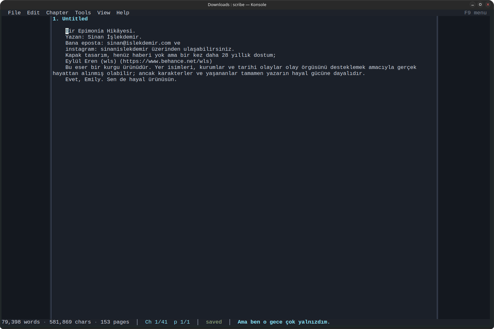
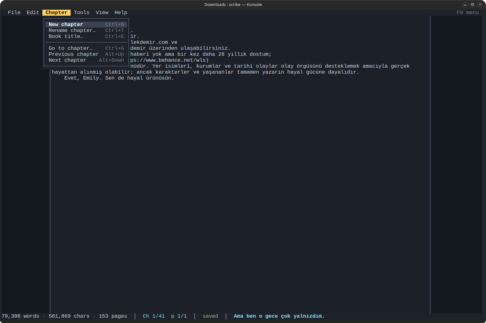
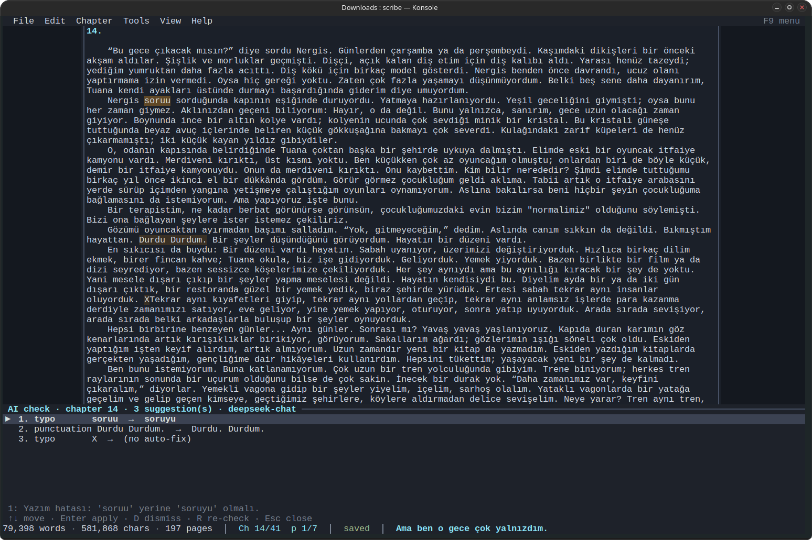
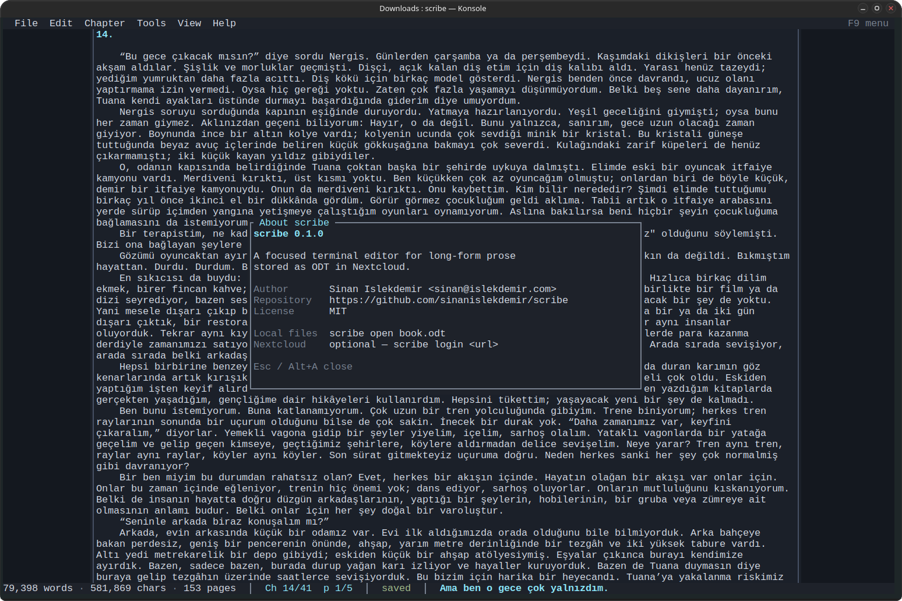

# scribe

A focused terminal editor for long-form prose stored as **ODT**. It works with local `.odt` files out of the box; Nextcloud storage is optional.

Author: Sinan Islekdemir <sinan@islekdemir.com> · Repository: <https://github.com/sinanislekdemir/scribe> · License: MIT

Built for a narrow document shape:

- one H1 = book title
- H2 = chapters
- normal paragraphs with an automatic first-line indent
- each chapter starts on a new page
- bold / italic with real ODT character styles

The TUI is intentionally small: one chapter at a time, a centered 120-column text area, terminal-sized pages, total word/char/page counts, and autosave.

<p align="center">
  
  <br>
  <em>One chapter at a time, with live word/char/page counts and autosave status.</em>
</p>

## Screenshots

**Chapter menu** — `F9` opens the menu bar; the `Chapter` menu creates, renames, and navigates chapters.



**AI writing check** — `F8` sends the current chapter to an OpenAI-compatible endpoint and lists suggestions for explicit approval.



**About** — `Alt+A` shows the version, author, repository, and license.



## Build

```bash
cd ~/projects/scribe
cargo build --release
```

The binary is `target/release/scribe`. To install the `scribe` command:

```bash
cargo install --path .
```

No system libraries are required beyond the Rust toolchain. ODT reading/writing, WebDAV, and the TUI are all Rust dependencies.

Prebuilt binaries are published on the [Releases](https://github.com/sinanislekdemir/scribe/releases) page:

- **Linux x86_64** — static (musl), no glibc dependency
- **Linux arm64** — static (musl), no glibc dependency
- **macOS universal** — Intel and Apple Silicon in one binary

Releases are built automatically from version tags such as `v0.1.0`.

## Local-only use

No Nextcloud account is required to try the editor:

```bash
scribe open path/to/book.odt
scribe path/to/book.odt
```

If the file does not exist, it is created. With no credentials, running `scribe` with no arguments offers a local-file option as well.

## Nextcloud (optional)

Browser login using Nextcloud Login Flow v2:

```bash
scribe login
scribe login https://cloud.example.com
```

If you omit the URL, scribe prompts for your server address. The server is not hardcoded; use your own Nextcloud instance or skip this section entirely.

It opens the login URL with `xdg-open` (or prints it if no browser is available), waits for approval, receives a generated app password, verifies WebDAV access, and saves it to:

```
~/.config/scribe/credentials.toml   (mode 0600)
```

Manual app-password login:

```bash
scribe login --manual
```

Remove local credentials:

```bash
scribe logout
```

The generated app password can be revoked later in Nextcloud → Settings → Security.

## Run

```bash
scribe
```

On first run with no credentials it offers Nextcloud login, a local `.odt` file, or quit. Once credentials exist, it opens the remote file picker.

Local files also work at any time:

```bash
scribe open path/to/book.odt
scribe path/to/book.odt
```

Only `.odt` files are accepted. `.docx` is not supported at any level.

## Keybindings

| Key | Action |
|---|---|
| `F9` | Open/close the top menu (arrows navigate, Enter runs) |
| `F8` | AI writing check for the current chapter (opens the suggestions panel) |
| `Ctrl+O` | Open an ODT from Nextcloud |
| `Ctrl+S` | Save now |
| `Ctrl+N` | Create a chapter after the current one |
| `Ctrl+T` | Edit current chapter title |
| `Ctrl+E` | Edit book title |
| `Ctrl+G` | Goto chapter (fuzzy-free list, `e` edits title) |
| `Ctrl+Space` | Start/end mark; the range between mark and cursor is selected |
| `Esc` | Clear the active selection (or close a menu/dialog) |
| `Alt+Up` / `Alt+Down` | Previous / next chapter |
| `Ctrl+B` / `Alt+B` | Toggle bold on the current word |
| `Alt+I` | Toggle italic on the current word |
| `Ctrl+Z` / `Ctrl+Y` | Undo / redo |
| `Backspace` / `Delete` | Delete character / merge paragraphs; deletes the selection when active |
| `Ctrl+W` / `Ctrl+Delete` | Delete previous / next word |
| `Ctrl+U` / `Ctrl+K` | Delete to paragraph start / end |
| `Ctrl+Shift+K` | Delete whole paragraph |
| `Left` / `Right` | Move by character |
| `Ctrl+Left` / `Ctrl+Right` | Move by word |
| `Up` / `Down` | Move by visual line |
| `Home` / `End` | Start / end of visual line |
| `Ctrl+Home` / `Ctrl+End` | Start / end of chapter |
| `PgUp` / `PgDn` | Previous / next page (and chapter at boundaries) |
| `Ctrl+L` | Full screen redraw (recover a corrupted terminal) |
| `Alt+H` | Help (`F1` also works where the terminal passes it through) |
| `Alt+A` | About scribe (author, repository, license) |
| `Ctrl+Q` | Save and quit |

The top menu bar is always visible. Press `F9` to focus it, use `←`/`→` to switch menus, `↑`/`↓` to choose an item, and `Enter` to run it. `Esc` or `F9` closes the menu. Every command in the menu is also available through the shortcuts above.

`File → Download a copy` is available for Nextcloud files and has no keyboard shortcut. It writes the current document, including unsaved edits, to `existing/` in the directory where `scribe` was started, creating the directory if needed. The cloud file's name is kept; if a file with that name is already there, the copy becomes `<name>_<unix-seconds>.odt`.

Marking works like this: press `Ctrl+Space` at the start, move with any cursor keys (`PgUp`/`PgDn`, `Ctrl+Home`/`Ctrl+End`, etc.), then press `Ctrl+Space` again to finish the mark. The selected range is highlighted and the status bar shows `SEL n`. `Delete` or `Backspace` removes it; typing replaces it; `Ctrl+B` / `Alt+I` applies bold/italic to it. `Esc` clears the mark. A mark is limited to the current chapter.

Bold/italic applies to the marked range when there is one, otherwise to the word under the cursor, or to the next typed text when the cursor is between words. A `B*` / `I*` indicator means the style is pending for the next typed text. `Alt+I` is used for italic because most terminals send `Ctrl+I` as Tab.

Typing a double or single quote produces a curly quote automatically. The editor uses the preceding character to choose opening vs closing. This also handles apostrophes: `Anette'nin` becomes `Anette’nin`, while `'dialogue'` becomes `‘dialogue’`. Pasted text and existing straight quotes are left unchanged.

Typing at the start of a sentence capitalizes the first letter automatically: at a paragraph start, or after `.`, `!`, or `?` followed by whitespace. Opening quotes and brackets are taken into account, so `"hello"` at a paragraph start becomes `“Hello”`. Turkish dotted `i` becomes `İ`, not `I`. Only typed text is affected; pasted text is never rewritten.

Undo works in words rather than keystrokes: `Ctrl+Z` removes the last typed word, and typing in a new place starts a fresh undo step. Newlines, paste, and formatting changes remain separate undo steps.

## Autosave

- 2 seconds after typing stops: local cache / local file
- 8 seconds after typing stops: upload to Nextcloud
- Chapter switches, `Ctrl+S`, and `Ctrl+Q` flush immediately
- Remote conflicts use ETag detection and show Overwrite / Reload / Save-copy options
- Offline edits stay in the local cache and retry in the background

Status line:

```
42,318 words · 231,044 chars · 187 pages │ Ch 4/12 p 2/7 │ saved
```

Page counts are **terminal pages** at the current width/height, not printed ODT pages.

## AI writing check

`F8` (or `Tools → Check writing (AI)…`) sends the **current chapter** to an
OpenAI-compatible endpoint and opens a suggestions drawer above the status bar.
Nothing is changed automatically: each suggestion must be applied explicitly.

Setup:

```bash
scribe ai-config          # base URL, model, API key, language
scribe ai-config --show   # show the config, key masked
scribe ai-config --test   # tiny request to verify the endpoint
```

The config lives in `~/.config/scribe/ai.toml` (mode 0600), separate from the
Nextcloud credentials:

```toml
base_url = "https://api.deepseek.com/v1"
model = "deepseek-chat"
api_key = "sk-..."
language = "auto"          # auto | tr | en
json_mode = true
timeout_seconds = 60
```

Ollama's OpenAI-compatible endpoint works too:

```toml
base_url = "http://127.0.0.1:11434/v1"
model = "qwen2.5:7b"
api_key = ""
```

`SCRIBE_AI_API_KEY`, `SCRIBE_AI_BASE_URL`, and `SCRIBE_AI_MODEL` override the
file without editing it.

Panel keys:

| Key | Action |
|---|---|
| `↑` / `↓`, `PgUp` / `PgDn`, `Home` / `End` | Move between suggestions |
| `Enter` / `A` | Apply the selected suggestion |
| `D` / `X` / `Delete` | Dismiss the selected suggestion |
| `R` | Run the check again |
| `Esc` / `F8` | Close the panel |
| `Ctrl+Z` / `Ctrl+Y` | Undo/redo and close the panel |

The check reports typos, wrong diacritics, duplicated words, agreement and
punctuation errors, and genuinely broken sentences. It is deliberately
conservative: style, tone, voice, word choice, deliberate fragments, dialogue,
dialect, and artistic choices are not flagged, and the request asks the model
not to rewrite or translate. Turkish and English are supported (`language =
"auto"` detects the text; set `tr` or `en` to pin it).

Applying a suggestion replaces only the exact quoted span, keeps the surrounding
text and bold/italic, and is a normal undo step (`Ctrl+Z`). Suggestions whose
text no longer matches are dropped instead of guessed. If the chapter changes
while a request is running, the result is discarded and you can press `R` to run
again.

Privacy: the current chapter is sent to the configured endpoint. Local Ollama
keeps it on the machine; DeepSeek/OpenAI receive it over HTTPS.

## File locking

Opening a Nextcloud file creates a sidecar lock next to it:

```text
/Books/Novel.odt  →  /Books/Novel.odt.lock
```

The lock is a visible file, not a dotfile, because some reverse-proxy
configurations reject hidden paths with 403 before the request reaches
Nextcloud. It is still hidden from the `scribe` file picker because only `.odt`
files are listed.

The lock is created atomically with a WebDAV conditional write, so only one
`scribe` instance can open the file. If another instance already has it, the
new opener shows:

```text
[K] Kick the other instance and open here
[C] Cancel
```

Kicking asks the old instance to save its latest edits, release the lock, and
exit. The old instance prints:

```text
Enforced exit by the new editor (host / user).
```

The new opener waits up to 10 seconds for the release. If the old instance is
crashed or offline, it then offers:

```text
[F] Force open anyway (it may not have saved)
[C] Cancel
```

Normal quit and switching files release the lock. A crash leaves the sidecar in
place; the next opener can kick or force it. A lock file can be deleted manually
from Nextcloud if necessary; the editor that owns it will save its cache and
exit safely when it notices.

This sidecar only coordinates `scribe` instances. Nextcloud web editing,
ONLYOFFICE, and desktop clients do not honor it; ETag conflict handling remains
the fallback for changes made by those clients.

## ODT behavior

- New documents use a template matching the sample: Letter page, 1-inch margins, Title 28pt Arial, Heading 2 16pt, Normal 12pt Book Antiqua, justified, 1.27cm first-line indent.
- Existing `.odt` files are edited in place: the package, `styles.xml`, page layout, fonts, and original automatic styles are preserved.
- `content.xml` is rewritten from the simple book model.
- Chapter headings after the first get `fo:break-before="page"`; chapter 1 shares page 1 with the title.
- Real bold/italic character styles are written to the ODT. The TUI also colors them: bold orange, italic purple, both pink.
- Documents containing tables, images, frames, lists, sections, footnotes, comments, tracked changes, hyperlinks, fields, or drawings are refused with a clear list. Edit those in OnlyOffice.
- ODT package writes are atomic; `mimetype` remains the first, uncompressed zip entry.

## Backups

Every successful save keeps a copy under:

```text
~/.cache/scribe/backups/<book-name>-<hash>/<timestamp>.odt
```

- One directory per file (keyed by the remote path or local absolute path).
- The last 100 distinct saved versions are kept per file.
- Backups are pruned automatically; no restore command is built in.
- Inspect with `ls -lt` and copy the `.odt` you want back into Nextcloud or open it locally.
- Backup files are mode `0600`; the backup directories are `0700`.

Local-file saves back up on every successful local write. Remote saves back up after each successful upload.

## Configuration and cache

```
~/.config/scribe/credentials.toml
~/.config/scribe/ai.toml
~/.cache/scribe/files/<hash>.odt
~/.cache/scribe/files/<hash>.json
```

`credentials.toml` contains the server URL, login name, generated app password, last folder, and last file.
`ai.toml` (mode 0600) contains the OpenAI-compatible endpoint, model, API key, and language for the writing check; see [AI writing check](#ai-writing-check).

On the first run after the rename, `scribe` copies the old
`~/.config/mydocs-tui/credentials.toml` if the new file is missing, and moves
`~/.cache/mydocs-tui` to `~/.cache/scribe` when the new cache does not exist.
The old credentials file is left in place.

## Troubleshooting

If the screen gets corrupted by another process writing to the same terminal (browser logs, background jobs, etc.), press `Ctrl+L` to force a full redraw. Browser launches during login now have their stdin/stdout/stderr detached, so they should not write into the TUI. If a previously launched browser already owns that terminal, close it or start `scribe` in a fresh terminal/tmux session.

## Releasing

Bump the version in `Cargo.toml`, commit it, then push a matching tag:

```bash
git tag -a v0.1.1 -m "scribe v0.1.1"
git push origin v0.1.1
```

The release workflow checks that the tag matches `Cargo.toml`, builds static Linux x86_64/arm64 binaries plus a macOS universal binary, and publishes the tarballs with `SHA256SUMS` on the Releases page.

## Development

```bash
cargo test
cargo fmt
cargo clippy
cargo run -- open /path/to/book.odt
```

Hidden maintenance commands:

```bash
scribe inspect book.odt
scribe roundtrip in.odt out.odt
```

The roundtrip command is useful for checking that the ODT writer preserves a file correctly; `soffice --headless --convert-to pdf` is a good external sanity check.
